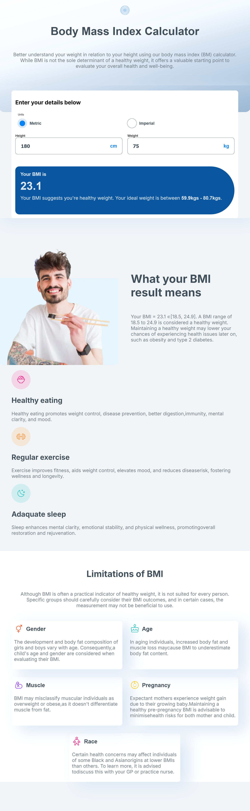

Frontend Mentor - Body Mass Index Calculator

This is my solution to the Body Mass Index Calculator challenge on Frontend Mentor. The project helped me practice building a responsive React application, handling user input, and separating calculation logic from the user interface.

Table of Contents

Overview

The Challenge

Screenshot

Links

My Process

Development Process

Built With

What I Learned

Continued Development

Useful Resources

AI Collaboration

Author

Acknowledgments

Overview

The Challenge

Users should be able to:

Choose between metric and imperial units.

Enter their height and weight.

View their calculated BMI, weight classification, and healthy weight range.

Use a responsive interface that adapts to different screen sizes.

See hover and focus states on interactive elements.

Screenshot

Links

Frontend Mentor Solution: 
https://www.frontendmentor.io/solutions/body-mass-index-calculator-using-html-css-js-react-and-mvc-gaXjRvkrnM

Live Site: https://andreschernin.github.io/BMI-Calculator/View.html

My Process

Development Process

Phase 1: Introduction and BMI Calculation

I created the IntroductionComponent to explain what BMI is and provide users with basic information about its purpose.

I also developed the ComputationComponent, which handles the user's measurements and displays the calculated BMI. This established the core functionality of the application.

Phase 2: BMI Model and Controller

I implemented the BMI calculation logic and connected it to the user interface using two classes: BMIModel and BMIController.

The BMIModel processes the user's measurements and provides the relevant BMI information. It uses a data object containing BMI classifications, healthy weight ranges, and explanations for the calculated result.

The BMIController connects the view and the model. It validates user input, determines which measurement system is being used, and passes the measurements to the model. The resulting BMI, classification, and explanation are then displayed in the interface.

Separating these responsibilities made the application easier to understand, maintain, and extend.

Phase 3: BMI Results and Explanations

I improved the results section by adding an image and displaying explanations for the calculated BMI. Instead of showing only a numerical result and weight classification, the application also provides context to help users understand the result.

Phase 4: Healthy Tips and BMI Limitations

I added a section with tips related to maintaining a healthy lifestyle and another section explaining the limitations of BMI as a health indicator.

I stored the content for these sections in separate data files so that it could be maintained and updated without modifying the corresponding component code.

Built With

Semantic HTML5

CSS

JavaScript (ES6+)

React

Object-oriented programming with a model-controller structure

Responsive web design

What I Learned

One of my main learning goals was to separate calculation logic from presentation logic. Implementing BMIModel and BMIController helped me understand how different responsibilities can be organized into separate classes.

I also gained experience with React state management, handling user input, validating measurements, and updating the displayed results when the user changes values or switches between metric and imperial units.

Another important learning experience was working on responsive layouts and organizing content into reusable components.

Continued Development

I would like to continue improving my understanding of responsive web design.

In particular, I want to refine the layout where the introduction section overlaps with the calculation component and improve the desktop layout of the LimitationSection.

I also want to keep improving input validation and error handling so that incomplete or invalid measurements are handled consistently.

Useful Resources

Frontend Mentor — Provided the challenge and design requirements.

React Documentation — Helped me understand React components, state, and event handling.

MDN Web Docs — A reference for HTML, CSS, and JavaScript.

The Markdown Guide — Useful for structuring and formatting this README.

AI Collaboration

I used ChatGPT as an AI assistant during development to discuss implementation decisions, investigate bugs, review input-validation logic, and improve the project documentation.

I treated the suggestions as guidance and evaluated whether they matched my actual implementation before applying changes.

Author

Frontend Mentor: @AndresChernin

Acknowledgments

Thanks to Frontend Mentor for providing the challenge and design reference. The project was also an opportunity to practice structuring a React application and reflect on areas I want to improve in future projects.
